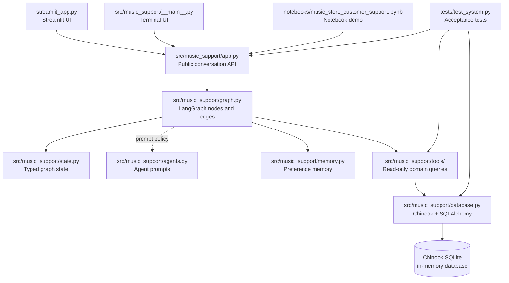
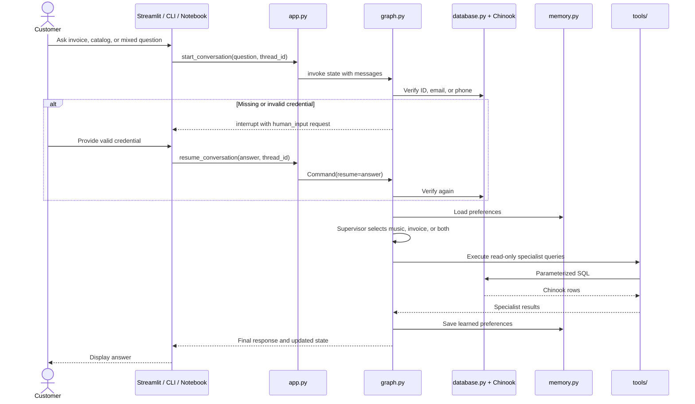
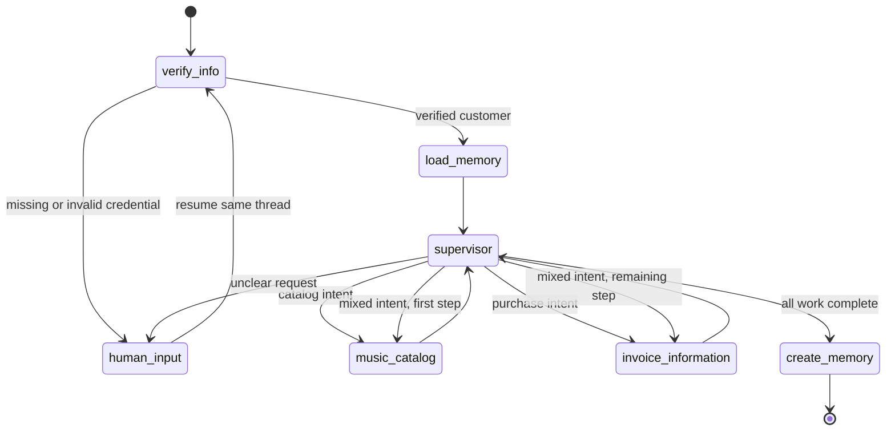

# Code Map and Runtime Diagrams

## Folder connections

## File responsibilities

| Path | Responsibility | Connects to |
| --- | --- | --- |
| `streamlit_app.py` | Browser UI, chat history, session reset, and interrupt answers. | `app.py` |
| `src/music_support/__main__.py` | Terminal UI for the same workflow. | `app.py` |
| `src/music_support/app.py` | Small public API: create, start, and resume a conversation. | `graph.py`, Streamlit, CLI, notebook |
| `src/music_support/graph.py` | Implements verification, human input, memory load/save, supervisor routing, specialist work, and graph edges. | `state.py`, `memory.py`, `tools/` |
| `src/music_support/state.py` | TypedDict state and LangGraph message reducer. | `graph.py` |
| `src/music_support/agents.py` | The PDF-required role prompts for supervisor, music, and invoice agents. | Future LLM-backed agent layer; routing policy is currently deterministic in `graph.py` |
| `src/music_support/memory.py` | Customer preference store keyed by verified customer ID. | `graph.py` |
| `src/music_support/tools/catalog.py` | Album, track, genre, and song-existence queries. | `database.py` |
| `src/music_support/tools/invoices.py` | Invoice, invoice-line, and employee queries. | `database.py` |
| `src/music_support/database.py` | Downloads the supplied Chinook SQL, builds the in-memory SQLite engine, and exposes safe parameterized reads. | Chinook URL, SQLAlchemy, tools |
| `src/music_support/config.py` | Database URL and model configuration. | `database.py`, agent layer |
| `tests/test_system.py` | Verifies tables, every tool, mixed routing, verification, interruption, memory, and invalid IDs. | All backend layers |
| `notebooks/music_store_customer_support.ipynb` | Human-readable demonstrations of the PDF scenarios. | `app.py`, `database.py` |
| `.streamlit/config.toml` | Streamlit theme and server defaults. | `streamlit_app.py` |
| `requirements.txt` | Runtime, notebook, UI, and test dependencies. | Virtual environment |
| `pyproject.toml` | Installable `src/` package metadata. | Virtual environment |

## Request lifecycle

## Graph routing

## PDF alignment

- The supplied `sqlite3`, `requests`, `SQLDatabase`, `create_engine`, and
  `StaticPool` setup is in `database.py`.
- The supplied `TypedDict`, `Annotated`, `add_messages`, and `RemainingSteps`
  state pattern is in `state.py`.
- The requested catalog and invoice function names are preserved in `tools/`.
- Verification accepts customer ID, email, and phone, mapping credentials to the
  canonical database customer ID before invoice access.
- Memory is loaded before routing and saved after the response.
- Human-in-the-loop uses LangGraph `interrupt` and `Command(resume=...)`.
- Mixed questions run both specialist paths before `create_memory` finalizes the
  answer.