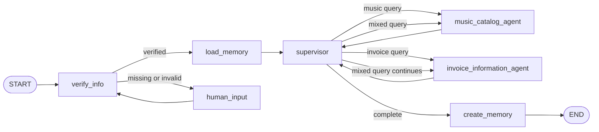

# Music Store Customer Support: System Design

## 1. Scope

The system answers customer questions about a digital music store. It supports
catalog questions, invoice questions, mixed multi-step questions, customer
verification by customer ID, email, or phone, and preference-aware recommendations.

Sensitive invoice information is available only after verification. Missing or
invalid credentials and unclear requests pause the workflow for human input.

## 2. Architecture



The supervisor is the routing boundary. Specialist agents do not decide whether
the customer is authenticated; they only use tools appropriate to their domain.

## 3. Repository structure

```text
.
├── docs/
│   └── system-design.md
├── notebooks/
│   ├── README.md
│   └── music_store_customer_support.ipynb
├── src/music_support/
│   ├── __init__.py
│   ├── agents.py
│   ├── config.py
│   ├── database.py
│   ├── graph.py
│   ├── memory.py
│   ├── state.py
│   └── tools/
│       ├── __init__.py
│       ├── catalog.py
│       └── invoices.py
├── .env.example
├── .streamlit/
│   └── config.toml
├── streamlit_app.py
├── requirements.txt
├── tests/
│   └── test_system.py
└── README.md
```

## 4. Graph state

The PDF specifies a `TypedDict` state with `customer_id`, `messages`, and
`loaded_memory`, plus LangGraph's `add_messages` reducer and `RemainingSteps`.
The implementation keeps those fields and adds only routing fields needed to make
interrupt/resume and multi-step routing explicit:

- `customer_id`: verified customer identifier, stored as short-term session data.
- `customer_request`: original request preserved while credential input is collected.
- `messages`: complete conversation history; new messages are appended.
- `loaded_memory`: serialized preferences loaded before routing.
- `pending_input`: human-in-the-loop request waiting for an answer.
- `awaiting_human`: explicit flag distinguishing a credential answer from a new request.
- `requested_agents`: specialist work selected by the supervisor.
- `completed_agents`: specialist work already completed for this request.
- `response_parts`: specialist results collected before final response creation.
- `final_response`: response assembled for the customer.
- `remaining_steps`: recursion budget managed by LangGraph.

## 5. Component responsibilities

### Database layer

`database.py` contains the supplied Chinook initialization pattern: download the
SQL script, create an in-memory SQLite connection, execute the script, and expose
one SQLAlchemy engine through `StaticPool`. The initial validation must confirm
that `Customer`, `Invoice`, `Artist`, `Album`, `Track`, and `Employee` are present.

### Catalog tools

`tools/catalog.py` owns read-only queries for:

- albums by artist;
- tracks by artist;
- songs by genre;
- exact or case-insensitive song existence checks.

### Invoice tools

`tools/invoices.py` owns read-only queries for:

- customer invoices ordered by date, newest first;
- customer invoice lines ordered by unit price, highest first;
- employee information associated with an invoice and customer.

These tools receive a verified `customer_id` from graph state rather than trusting
an identifier invented by the model.

### Verification node

The node extracts a customer ID, email, or phone from the conversation and maps
email/phone to the canonical customer ID using the database. On zero or multiple
matches it creates `pending_input` and routes to `human_input`. No invoice tool is
called before verification succeeds.

### Memory layer

The first implementation uses an in-memory dictionary keyed by customer ID. It
stores compact preference data such as artists, genres, and the conversation's
useful recommendation context. This is deliberately isolated behind `memory.py`
so it can later be replaced by a persistent checkpointer or store.

### Supervisor and specialists

The supervisor classifies the request as music, invoice, mixed, or unclear. It may
select both specialists for a mixed request and must wait for all selected work to
finish before finalizing. Specialists return structured results to the supervisor,
which owns the customer-facing response.

### Human-in-the-loop

`human_input` is a graph node, not a direct `input()` call inside a tool. The graph
will interrupt with a clear request for credentials or a valid query. Resuming the
same thread supplies the human answer and returns to verification or supervisor
routing without losing messages or `customer_id`.

## 6. Invariants

1. Invoice data is never queried before successful verification.
2. Every graph step appends messages instead of replacing conversation history.
3. A mixed request can execute both specialists before the final response.
4. A missing credential or unclear request pauses rather than fabricating data.
5. Memory is loaded before recommendations and saved after the request completes.
6. The same session keeps the verified customer ID for follow-up questions.

## 7. Implementation order

1. Verify database initialization and required Chinook tables.
2. Implement and test catalog and invoice SQL tools.
3. Implement the typed state and deterministic verification node.
4. Add memory load/save behavior.
5. Add specialist prompts and supervisor routing.
6. Assemble interrupt/resume graph behavior.
7. Add notebook demonstrations for the two PDF test scenarios.

## 8. Code map and diagrams

The detailed file-by-file map and connection diagrams are in
[docs/code-map.md](code-map.md). It explains which folder owns each concern and
shows how the UI, graph, state, tools, database, memory, and tests connect.